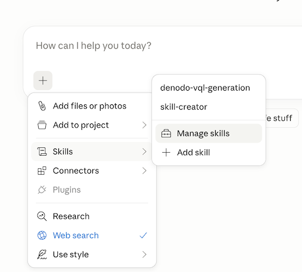
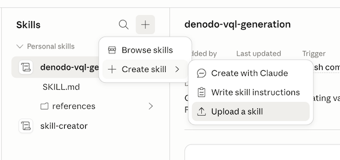

# Denodo skills

This repository contains [**skills**](https://agentskills.io/) that teach AI agents how to work with the [Denodo Platform](https://www.denodo.com/).

## VQL Generation Skill

The **`denodo-vql-generation`** skill shows AI agents how to write valid VQL to interact with the Denodo Platform.

This skill complements the [**Denodo MCP server**](https://community.denodo.com/docs/html/document/denodoconnects/latest/en/Denodo%20MCP%20Server%20-%20User%20Manual). Not to be confused with the with the **AI SDK MCP server** shipped with the [Denodo AI SDK](https://github.com/denodo/denodo-ai-sdk/): that stack is agentic and already drives **text-to-VQL** generation without the need of the **`denodo-vql-generation`** skill.

## Installation

### Claude Desktop

To install this skill in Claude Desktop, first create a .zip file of the contents of the skill you're trying to install. For example, the `denodo-vql-generation` skill. *NOTE*: Zip the contents, do not include the top-level `denodo-vql-generation` folder inside the .zip. Then, open Claude Desktop and click on "Manage skills" in the homepage, as seen here:



Afterwards, click Create a skill => Upload a skill and upload the .zip file you uploaded, like so:



That's it. The skill will now be able to Claude for usage with the VDP MCP server.

### Agentic CLIs and IDEs

To use this skill with agentic CLIs (like Claude Code) or agentic IDEs (such as Cursor), locate your tool's skills directory (for example, `.claude/skills/`) and copy the `denodo-vql-generation` folder into it. Your final directory structure should look like this:

```
.claude/
└── skills/
    └── denodo-vql-generation/
        ├── SKILL.md
        ├── LICENSE.txt
        └── references/
```

